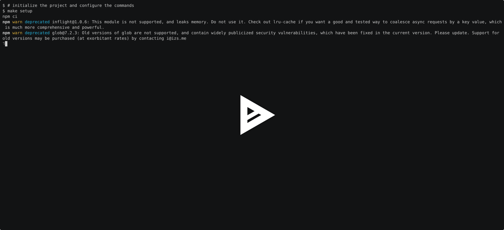
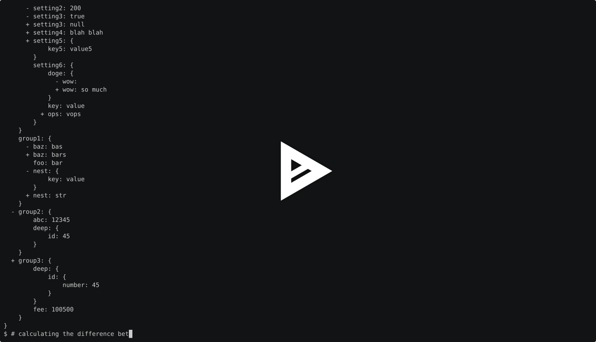
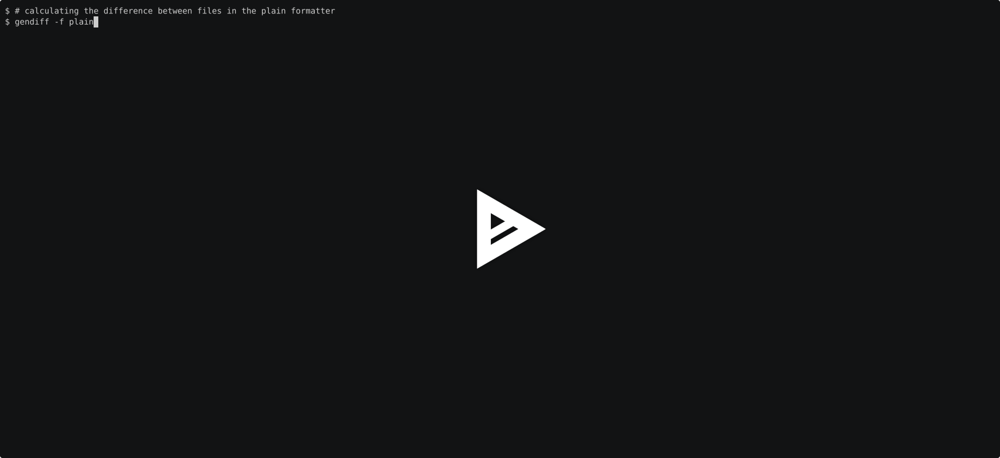

### Hexlet tests and linter status:
[](https://github.com/myxtaridse/frontend-project-46/actions) [](https://github.com/myxtaridse/frontend-project-46/actions/workflows/test-check.yml) [](https://sonarcloud.io/summary/new_code?id=myxtaridse_frontend-project-46)

# Вычислитель отличий

**«Вычислитель отличий»** - это инструмент командной строки, который выявляет различия между двумя структурами данных и формирует отчет в выбранном формате.

## Требования:
- Unix system (Macos/Linux)
- Nodejs 22.x+
- Make

## Описание:
Библиотека предоставляет:
- **Поддержка форматов:** сравнение файлов в форматах JSON, YAML и YML
- **Вложенные структуры**: рекурсивное сравнение свойств на разных уровнях вложенности
- **Разные форматы вывода**: возможность получить результат сравнения в одном из трех форматов:
  - stylish - древовидное представление различий
  - plain - текстовое описание изменений
  - json - структурированный JSON-отчет

## Установка:
```bash
git clone https://github.com/myxtaridse/frontend-project-46.git
cd frontend-project-46
make setup
```

## Использование:
Для сравнения двух файлов:
```bash
gendiff <filepath1> <filepath2>
```
По умолчанию результат выводится в формате stylish.

[](https://asciinema.org/a/i6dwSN2CNsg31t68)


### Форматы вывода:

#### Stylish
Отображает различия в виде дерева, визуально напоминающего структуру объекта. Удаленные свойства обозначаются знаком "-", добавленные - "+", при изменении значения выводятся в две строки: сначала старое значение с "-", затем новое с "+", неизменные выводятся без знака.

```bash
gendiff -f stylish <filepath1> <filepath2>
```

[](https://asciinema.org/a/TdSN3hJTzfH74oBK)


#### Plain text
Представляет изменения в виде текстового описания: какие свойства были добавлены или удалены, а какие значения изменились. Для вложенных свойств указывается полный путь от корневого объекта.

```bash
gendiff -f plain <filepath1> <filepath2>
```

[](https://asciinema.org/a/XHhFWdZWicTZBtZr)


#### JSON
Выводит результат сравнения в структурированном формате JSON. Такой формат позволяет использовать полученные данные для дальнейшей обработки другими программами.

```bash
gendiff -f json <filepath1> <filepath2>
```

[](https://asciinema.org/a/3xqXEJu3JM3Ni7XO)


## Run tests
```Bash
make test
```
